<p align="center">
  
</p>

<p align="center">
  <a href="LICENSE"></a>
  <a href="https://agentskills.io"></a>
  
  
  <a href="#eval-có-và-không-có-skill"></a>
</p>

<p align="center"><a href="README.md">English</a> · <b>Tiếng Việt</b></p>

Vibe code thì nhanh, nhưng phần mềm chạy thật cần thêm nhiều thứ prompt hay bỏ quên: hiểu đúng nghiệp vụ, test đi cùng code, dữ liệu khách này không lộ sang khách kia, migration không làm sập bản đang chạy, có đường rollback, backup đã restore thử. **vibe** gói những kinh nghiệm đó thành 12 [Agent Skills](https://agentskills.io) cho web, app mobile (iOS, Android), app desktop (Windows, macOS, Linux) và tính năng AI. Agent tự chọn đúng skill theo câu bạn nói, và chỉ đọc phần tài liệu cần cho việc đang làm.

Nội dung skill viết bằng tiếng Anh để agent nào cũng hiểu như nhau và tốn ít token hơn. Agent vẫn trả lời bạn bằng tiếng Việt, và tài liệu dự án (PRD, task card...) viết theo ngôn ngữ bạn dùng. Dùng được với mọi agent hỗ trợ chuẩn mở Agent Skills: Claude Code, OpenAI Codex, Cursor, GitHub Copilot, Gemini CLI, OpenCode, Cline, Goose, Roo Code, Amp, Windsurf...

## Cài đặt

**Mọi agent** (trình cài [`skills`](https://github.com/vercel-labs/skills) chép skill vào thư mục của từng agent):

```bash
npx skills add HoangThai18/vibe-code-pro
```

**Plugin cho Claude Code** (có thêm hai subagent; Claude Code 2.1.275 trở lên):

```bash
claude plugin install vibe --marketplace HoangThai18/vibe-code-pro
```

**Chép tay**: chép `plugins/vibe/skills/*` vào thư mục agent của bạn đọc.

| Agent | Thư mục trong dự án | Thư mục của user | Gọi lệnh |
|---|---|---|---|
| Claude Code | `.claude/skills/` | `~/.claude/skills/` | `/vibe-start` |
| OpenAI Codex | `.agents/skills/` | `~/.agents/skills/` | `$vibe-start` |
| Cursor | `.agents/skills/` hoặc `.cursor/skills/` | `~/.cursor/skills/` | `/vibe-start` |
| GitHub Copilot (VS Code, CLI) | `.github/skills/` hoặc `.agents/skills/` | `~/.copilot/skills/` | `/vibe-start` |
| Gemini CLI | `.agents/skills/` hoặc `.gemini/skills/` | `~/.gemini/skills/` | nói: "dùng vibe-start" |
| OpenCode | `.agents/skills/` hoặc `.opencode/skills/` | `~/.config/opencode/skills/` | nói: "dùng vibe-start" |
| Cline, Goose, Roo Code, Amp, Windsurf | `.agents/skills/` | `~/.agents/skills/` | `/vibe-start` (Windsurf: `@vibe-start`) |
| Kiro, Junie, Factory | `.kiro/skills/`, `.junie/skills/`, `.factory/skills/` | tương tự trong `~/` | `/vibe-start` |

```bash
git clone https://github.com/HoangThai18/vibe-code-pro
mkdir -p .agents/skills && cp -r vibe-code-pro/plugins/vibe/skills/* .agents/skills/
```

Cài đủ bộ: các skill gọi nhau bằng tên (`vibe-backend`, `vibe-tasks`...). Hướng dẫn cho agent của dự án nằm trong `AGENTS.md`; skill plan tạo thêm `CLAUDE.md` một dòng (`@AGENTS.md`) vì Claude Code đọc file đó.

## Lệnh nhanh

| Gõ | Để làm gì |
|---|---|
| `/vibe-start <ý tưởng>` | Dự án mới: làm rõ yêu cầu, phân tích nghiệp vụ, lên plan, chia task. Dự án có sẵn: khảo sát code, tạo `AGENTS.md`, chia task |
| `/vibe-status` | Tới đâu rồi: tiến độ, task đang làm, task bị chặn, việc nên làm tiếp |
| `/vibe-next [P1-T03]` | Làm việc tiếp theo (hoặc đúng task đó): code kèm test, cập nhật task card |
| `/vibe-check` | Trước khi merge: test, review độc lập, PASS hoặc BLOCK |
| `/vibe-fix <mô tả lỗi>` | Sửa bug, xử lý sự cố |
| `/vibe-ship <việc>` | Deploy, rollback, backup, giám sát |
| `/vibe-help` | Bảng lệnh và gợi ý lệnh nên dùng theo trạng thái dự án |

Một vòng: `/vibe-start` → `/vibe-next` → `/vibe-check` → merge → `/vibe-next`. Hoặc cứ nói bình thường: *"phân tích nghiệp vụ app đặt lịch spa"*, *"tới đâu rồi?"*, *"làm tiếp"*, *"lỗi 500 khi tạo khách"*.

**Nâng cấp từ 0.x**: mọi skill giờ có tiền tố `vibe-` (`/vibe:start` → `/vibe-start`, `/vibe:check` → `/vibe-check`) và được viết bằng tiếng Anh. Dự án mới dùng `AGENTS.md`; `CLAUDE.md` đang có được giữ nguyên và thêm dòng `@AGENTS.md`. Task card và `docs/` không cần đổi. Cập nhật bằng `claude plugin update vibe`, hoặc chạy lại `npx skills add HoangThai18/vibe-code-pro`.

## Quy trình

<p align="center">
  
</p>

Theo hướng Anthropic khuyến nghị cho agent: **một agent chính + skills + tools**. Kiến thức nằm trong skill và chỉ nạp khi cần; subagent chỉ dùng khi đáng (review độc lập, chạy song song việc lớn và độc lập). Mỗi phiên chỉ mang theo mô tả ngắn của skill: khoảng **3.6k token** cho 12 skill và 2 subagent (ước tính của `claude plugin details`), giảm từ 4.6k ở bản tiếng Việt. 5 lệnh nhanh không tốn token nào cho tới khi bạn gõ, trên các agent hỗ trợ `disable-model-invocation` (Claude Code, VS Code Copilot, Cursor).

| Skill | Lo phần | Tài liệu nạp khi cần |
|---|---|---|
| `vibe-plan` | Làm rõ yêu cầu, phân tích nghiệp vụ, research người dùng / đối thủ / tech stack, PRD, kiến trúc, chia phase, công cụ cho agent (Context7, Playwright, Chrome DevTools, Figma, Supabase, GitHub, LSP) | domain-analysis, tech-research, dev-tools, 7 template |
| `vibe-tasks` | Task card có deps và file sẽ đụng, tiến độ, việc tiếp theo, handoff giữa các phiên | `tasks.py`, template, ví dụ mini CRM |
| `vibe-architecture` | Code theo đúng quy ước của codebase; chọn kiến trúc hợp với yêu cầu (modular monolith, layered, hexagonal, DDD, CQRS, event, microservices); SOLID, pattern, refactor | codebase-conventions, architecture-styles, ddd, design-principles |
| `vibe-backend` | Schema, index, transaction, migration an toàn, 8 ORM, multi-tenant + Postgres RLS, API contract, xác thực và phân quyền, **job nền**, **bảo mật ứng dụng** (upload, SSRF, rate limit, quét secret), **dữ liệu cá nhân theo luật Việt Nam** | data-layer, orm, multi-tenant, postgres-rls, isolation-tests, api-contract, api-conventions, auth, jobs, app-security, privacy |
| `vibe-frontend` | Web: UI theo mockup (Claude Design, Figma), motion, state (TanStack Query, Zustand, Redux, Pinia...), đổi workspace an toàn | design-to-code, motion-spec, state-management |
| `vibe-mobile` | iOS và Android: chọn stack (Expo/React Native, Flutter, native, PWA), token trong Keychain/Keystore, hàng đợi ghi offline, push, deep link, test (Jest, Maestro), EAS Build, OTA, duyệt store, buộc cập nhật | choose-stack, app-data, platform-features, testing, release |
| `vibe-desktop` | Windows, macOS, Linux: Tauri / Electron / PWA, bảo mật Electron (isolation, sandbox, IPC kiểm nguồn gửi), token qua kho khoá hệ điều hành, test Playwright, ký số, notarize, tự cập nhật | choose-stack, security, app-data, testing, release |
| `vibe-ai` | Tính năng AI trong app: gọi Claude API từ server, structured output, streaming, chống prompt injection, cô lập tenant, ngân sách và usage theo tenant, test không tốn tiền, eval chất lượng | design, integration, safety, cost, testing |
| `vibe-build` | Một agent làm cả code lẫn test cho từng task, chọn mức test, **test giao diện và luồng người dùng bằng Playwright**, khi nào mới chạy song song | testing, e2e-playwright, parallel, agent-brief |
| `vibe-review` | Nghiệm thu có bằng chứng, verifier độc lập, PASS / BLOCK, báo cáo | checklist |
| `vibe-ship` | CI/CD, deploy kèm migration đúng thứ tự, feature flag, **rollback**, giám sát, **backup và restore**, bảo trì, **hiệu năng và kiểm tải** (k6, query chậm, Web Vitals) | ci-cd, release-rollback, observability, backup-restore, maintenance, performance |
| `vibe-fix` | Sửa bug bằng test tái hiện trước, sự cố production, nghi lộ dữ liệu, postmortem | template POSTMORTEM |

| Subagent | Khi nào dùng |
|---|---|
| `vibe-verifier` | Review độc lập: ngữ cảnh mới, chỉ đọc, chạy kiểm tra và soi diff mà không bị neo vào cách nghĩ của người viết code. Agent không có subagent thì skill review dùng một phiên mới thay thế |
| `vibe-implementer` | Chỉ khi chạy song song nhiều task **lớn và độc lập**, mỗi task một git worktree. Mặc định phiên chính tự làm |

## Tiến độ nằm trong repo, không nằm trong trí nhớ của chat

<p align="center">
  
</p>

Task card là file Markdown trong `docs/tasks/`, nên phiên nào, máy nào cũng làm tiếp được. `tasks.py` (Python 3.8+, không cần cài thêm) kiểm lỗi deps, xếp thứ tự, phát hiện hai task cùng sửa một file, và gợi ý đúng một việc tiếp theo:

```bash
S=plugins/vibe/skills/vibe-tasks
python3 $S/scripts/tasks.py status --dir $S/examples/mini-crm
python3 $S/scripts/tasks.py next   --dir $S/examples/mini-crm
```

## Đã chạy thật, không chỉ viết ra

Tài liệu cho phần mềm thật mà ví dụ sai thì còn hại hơn không có. Code, SQL, workflow được chạy thử trước khi đưa vào. Ở bản 1.0.0, phần chữ được dịch sang tiếng Anh; code giữ nguyên, chỉ đổi comment và tên test (đã so từng khối).

| Phần | Cách kiểm | Kết quả |
|---|---|---|
| Multi-tenant SQL: RLS, policy đọc/ghi tách riêng, composite FK, kiểm membership theo request, tra workspace trước đăng nhập, Supabase | Chạy nguyên văn trên PostgreSQL 16 bằng role app, kèm phép thử tấn công chéo tenant | Chặn đúng. Đã sửa hai lỗ của bản nháp: policy có `OR` cho ghi chéo tenant, và bảng slug ghi được bằng role app |
| Backup và restore | `pg_dump` bằng role backup, restore sang cluster mới bằng admin không phải superuser, kiểm owner, RLS, số dòng, migration tiếp theo | 0 lỗi; bắt được 2 lỗi thật của tài liệu cũ |
| Test giao diện Playwright | 21 test, lặp 5 lần × 4 worker, trên app thường, app huỷ request khi đổi trang, app có `role="alert"` kiểu Next.js | Không chập chờn; hai test đổi workspace fail mọi lần trên hai bản app cố ý cài lỗi |
| Test cô lập tenant | Trên app đúng và 3 bản lỗi | Bắt được cả 3; phần đối chứng bắt được test "pass mà không kiểm gì" |
| 8 ORM | "Trừ kho + tạo đơn" trên PostgreSQL 16: còn hàng, hết hàng, hai transaction tranh nhau | Đạt cả 8; bắt được lỗi bán vượt tồn ở bản nháp |
| Ví dụ TypeScript (DDD, state, auth, webhook, `426 app_update_required`) | `tsc --strict` + unit test | Đạt |
| App mobile Expo SDK 58 | `tsc --strict`, Jest khi chưa có cache, `eas.json` qua bộ đọc cấu hình của `eas-cli`, runtime version theo biến thể | Đạt; bắt được lỗi bản nháp (type TypeScript 6, Jest không thoát, quá giờ khi chưa có cache, quy trình OTA sai) |
| App desktop: bảo mật Electron, `safeStorage`, Tauri | Electron 45 + Playwright 1.64 (100 lượt liên tiếp) trên app mẫu và 8 bản cố ý cấu hình sai; build Tauri 2.12 thật | Bắt được cả 8; bắt được lỗi bản nháp |
| Tính năng AI | `@anthropic-ai/sdk` 1.3 với fetch giả, `tsc --strict`, bảng usage trên PostgreSQL 16, bỏ từng lớp bảo vệ | Đạt; bỏ lớp nào trong 5 lớp cũng có test fail. Eval gọi API thật chưa chạy (môi trường kiểm không có API key) |
| Job nền pg-boss | pg-boss 12.38 trên PostgreSQL 16 có RLS `FORCE`, worker thật | 6 test đạt; 4 lớp bảo vệ bị bỏ đều có test fail |
| Hiệu năng | k6 1.8.2 vào API mẫu 500.000 khách; Playwright + `web-vitals` 6 | Index đúng: p95 từ 2,74 giây xuống 1,97 ms; test ngân sách bắt được trang CLS 0,23 |
| Bảo mật ứng dụng | Node 22, PostgreSQL 16, gitleaks 8.30 | 12 test đạt; bỏ lớp chặn SSRF nào cũng có test fail; rate limit đúng 10/50; gitleaks bắt key giả kể cả khi file đã xoá |
| Dữ liệu cá nhân | PostgreSQL 16 có RLS; test hàm tính hạn | Đạt; phát hiện view thiếu `security_invoker` làm lộ dữ liệu giữa tenant |
| GitHub Actions (CI, deploy, E2E, kiểm tải, bảo mật) | actionlint | Đạt |
| Chuẩn Agent Skills | `agentskills validate` (bộ kiểm tham chiếu) cho cả 12 skill, chạy trong CI | Đạt |

Chưa chạy ở đây: dùng skill trong agent khác Claude Code (môi trường kiểm không có Codex, Cursor, Copilot hay Gemini). Skill theo đúng chuẩn và qua bộ kiểm của chuẩn; gặp lỗi xin mở issue.

## Eval: có và không có skill

`plugins/vibe/evals/` có 19 case: yêu cầu thật (bằng tiếng Việt, như người dùng gõ) kèm tiêu chí chấm. Phần lớn tiêu chí kiểm khách quan: công cụ nào được gọi, theo thứ tự nào (viết test và thấy fail trước khi sửa), nội dung file sau khi chạy, có spawn agent không. Mỗi case chạy 3 lượt có skill và 3 lượt không (`claude plugin eval`, model và judge mặc định của lệnh). Kết quả bản 1.0.0, chạy trong Claude Code:

| Case | Có skill | Không | Khác biệt chính |
|---|---|---|---|
| Màn danh sách chậm, team định thêm Redis | **1.00** | 0.56 | Kiểm tải có ngưỡng trên staging: 3/3 so với 0/3 |
| Sửa bug `slugify('Đường')` | **1.00** | 0.58 | Thấy test tái hiện fail trước khi sửa: 3/3 so với 0/3 |
| Khách yêu cầu xoá dữ liệu (luật Việt Nam) | **1.00** | 0.67 | Đúng văn bản đang hiệu lực và thời hạn (xác nhận trong 2 ngày làm việc, xoá trong 20 ngày): 3/3 so với 0/3 |
| Chọn kiến trúc cho team 3 người | **1.00** | 0.73 | Có điều kiện cụ thể để xem lại quyết định: 3/3 so với 0/3 |
| Chuyển token app mobile khỏi AsyncStorage | **0.94** | 0.72 | Xoá token Keychain còn sót sau khi cài lại app: 2/3 so với 0/3. Sau lượt chạy này, skill mobile được thêm một dòng về việc đó; chạy lại riêng case này: 3/3 so với 0/3, điểm 1.00 |
| Tính năng AI tóm tắt ghi chú khách | **1.00** | 0.75 | Có `max_tokens`, kiểm `stop_reason`, lỗi API thành thông báo dễ hiểu: 3/3 so với 0/3 |
| Phát hành app mobile vừa thêm `expo-camera` qua EAS Update | **1.00** | 0.75 | Tính đến người dùng bản cũ (khoá tính năng camera, OTA chỉ cho sửa JS): 3/3 so với 1/3 |
| Đổi workspace mà màn hình vẫn hiện dữ liệu cũ | **1.00** | 0.75 | Huỷ request và bỏ cache của workspace cũ: 3/3 so với 0/3 |
| "Tới đâu rồi, làm gì tiếp?" trên task card | **0.93** | 0.80 | Đúng bước tiếp theo: 2/3 so với 1/3 (lượt trượt vẫn đặt P1-T02 lên trước, nhưng sau đó định làm P1-T03 trước P1-T04) |
| Viết test Playwright cho luồng đổi workspace | **1.00** | 0.87 | Locator theo role/label: 3/3 so với 1/3 |
| Đổi tên cột không downtime | **1.00** | 0.93 | Bỏ NOT NULL (hoặc thêm default) cho cột cũ trước khi code ngừng ghi vào nó: 3/3 so với 2/3 |
| Backfill NOT NULL khi có FORCE RLS, RLS cho memberships, xem trước link (SSRF), theo pattern codebase, có nên chạy song song task nhỏ, bảo mật Electron, thiết kế job nhắc lịch | 1.00 | 1.00 | Không có skill cũng làm đúng |
| **Việc nhỏ** ("đổi chữ nút Lưu"): không dựng quy trình, không spawn agent | 1.00 | 1.00 | Skill không làm agent "quan liêu" hơn |
| **Trung bình 19 case** | **0.99** | 0.85 | Không case nào thấp hơn khi có skill |

So với bản 0.5.0 (skill tiếng Việt), cùng case và cùng thiết lập:

| | 0.5.0 | 1.0.0 |
|---|---|---|
| Điểm có / không có skill | 0.99 / 0.85 | 0.99 / 0.85 |
| Mô tả skill luôn nằm trong context | 4.581 token | 3.620 (−21%) |
| Nội dung SKILL.md, cả 12 skill | khoảng 22.400 token | khoảng 16.900 (−25%) |
| Chi phí mỗi lượt có skill so với không | 1,59 lần | 1,46 lần |
| Số lượt skill được nạp | 42/54 | 44/54 |

Skill tiếng Anh vẫn được gọi đúng khi yêu cầu viết bằng tiếng Việt, và agent vẫn trả lời bằng tiếng Việt. Năm lệnh tắt (`vibe-help`, `vibe-start`...) không nằm trong context cho tới khi bạn gõ.

Cái giá: agent đọc tài liệu của skill trước khi trả lời, nên mỗi lượt tốn khoảng 1,46 lần so với không có skill (vài cent mỗi lượt ở các case trên); việc nhỏ chỉ tốn thêm phần mô tả skill. Chạy lại sau mỗi lần sửa skill (mỗi lượt là một lần gọi model thật, tính phí theo tài khoản):

```bash
claude plugin eval ./plugins/vibe --runs 3 --no-publish --trust-plugin --scaffold --allow-tools "Bash" "Write" "Edit"
```

Linux cần `bubblewrap` và `socat` để sandbox của eval chạy được Bash.

## Dùng trong dự án

- `AGENTS.md` (skill plan tạo): lệnh, quy ước, quy tắc bắt buộc. Agent nào cũng đọc.
- Việc nhỏ (sửa chữ, đổi màu một nút) cứ làm thẳng: skill nào cũng có phần "cân đúng mức" để không dựng quy trình thừa.
- Chạy song song nhiều agent là tuỳ chọn, cần agent chạy được subagent hoặc nhiều phiên (cấu hình Claude Code ở `references/parallel.md` của `vibe-build`).

## Đóng góp

- Đọc [CONTRIBUTING.md](CONTRIBUTING.md). Nguyên tắc số một: ví dụ nào thêm vào cũng phải chạy được.
- Tác giả: thaiphan ([@HoangThai18](https://github.com/HoangThai18)). Giấy phép MIT.
