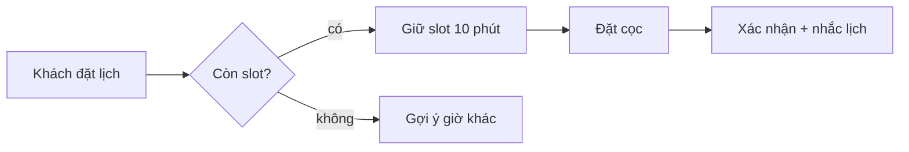
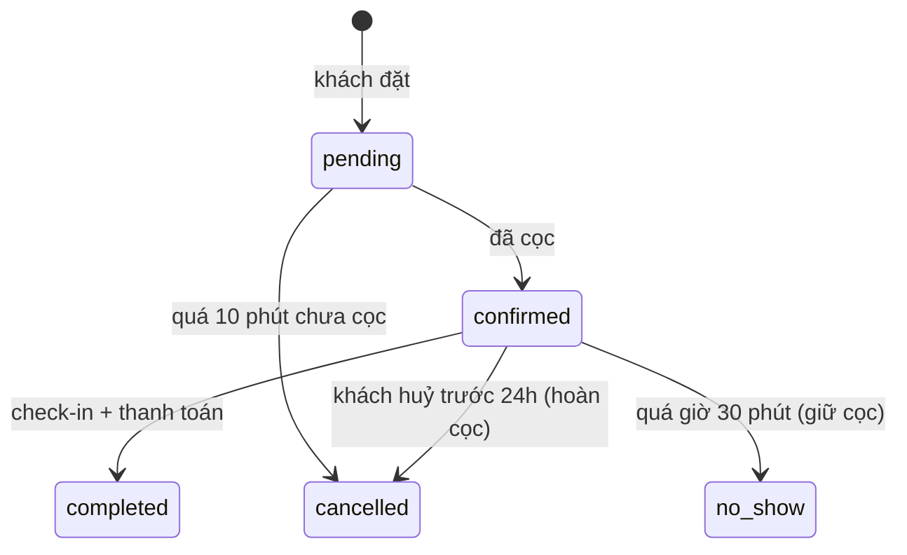

# Phân tích nghiệp vụ

Mục tiêu: hiểu đúng cách doanh nghiệp vận hành trước khi biến nó thành bảng, API và màn hình. Code sai nghiệp vụ vẫn pass test, vì test được viết theo cùng cách hiểu sai; chỉ người dùng thật mới phát hiện, và lúc đó sửa rất đắt.

## Mục lục
1. Thu thập thông tin
2. Thuật ngữ chung
3. Vai trò và quyền
4. Quy trình
5. Thực thể và vòng đời
6. Quy tắc nghiệp vụ
7. Ngoại lệ và trường hợp biên
8. Đưa kết quả vào các bước sau

## 1. Thu thập thông tin

- Hỏi user cách công việc **đang** được làm (Excel, Zalo, giấy, phần mềm cũ). Quy trình hiện tại cho biết những ngoại lệ mà mô tả lý tưởng thường bỏ sót.
- Xin mẫu thật: file Excel, hoá đơn, biểu mẫu, ảnh chụp màn hình phần mềm cũ. Một file Excel thật thường lộ ra nhiều quy tắc hơn một buổi mô tả.
- Research đối thủ và sản phẩm cùng ngành (WebSearch nếu có): tính năng nào là chuẩn mà người dùng sẽ mặc định đòi (vd phần mềm spa thì phải có nhắc lịch hẹn, thẻ trả trước, hoa hồng nhân viên).
- Ghi rõ nguồn của từng thông tin: user nói, tài liệu, hay mình suy luận. Điều suy luận phải được user xác nhận.

## 2. Thuật ngữ chung

Bảng thuật ngữ tiếng Việt ↔ tên trong code, dùng thống nhất ở tài liệu, UI, DB và API. Một khái niệm có hai tên ("khách" và "người dùng") là nguồn bug và hiểu lầm.

| Thuật ngữ | Định nghĩa | Tên trong code | Ghi chú |
|---|---|---|---|
| Khách hàng | Người sử dụng dịch vụ của spa | `customer` | Khác `user` (người đăng nhập hệ thống) |
| Lịch hẹn | Khung giờ khách đặt dịch vụ | `appointment` | |

## 3. Vai trò và quyền

Ma trận vai trò × hành động. Ghi rõ phạm vi: "nhân viên sửa lịch hẹn **của mình**" khác "nhân viên sửa **mọi** lịch hẹn của chi nhánh".

| Hành động | Chủ | Quản lý chi nhánh | Nhân viên | Khách |
|---|---|---|---|---|
| Xem doanh thu | ✅ toàn hệ thống | ✅ chi nhánh mình | ❌ | ❌ |
| Tạo lịch hẹn | ✅ | ✅ | ✅ | ✅ của chính mình |

## 4. Quy trình

Vẽ luồng chính bằng mermaid (flowchart hoặc sequence): ai làm gì, theo thứ tự nào, hệ thống phản hồi ra sao. Vẽ cả **hiện tại** và **mong muốn** khi phần mềm thay đổi cách làm việc của người dùng.

## 5. Thực thể và vòng đời

Với mỗi thực thể quan trọng: trường chính, quan hệ, và **state machine**: trạng thái nào, chuyển sang trạng thái nào, ai được chuyển, điều kiện, tác động phụ (gửi tin, hoàn tiền, trừ kho).

State machine trở thành CHECK constraint hoặc enum trong DB, hàm chuyển trạng thái trong service, và test cho từng chuyển đổi hợp lệ lẫn không hợp lệ.

## 6. Quy tắc nghiệp vụ

Đánh số để tham chiếu từ task card và test: `BR-01`, `BR-02`... Mỗi quy tắc phải kiểm chứng được.

- Tính toán: giá, chiết khấu, thuế VAT, hoa hồng, thứ tự áp dụng, **làm tròn** (VND không có số lẻ: làm tròn ở bước nào, lên hay xuống).
- Giới hạn: số lượng tối đa, thời hạn, hạn mức.
- Thời gian: múi giờ (lưu UTC, hiển thị Asia/Ho_Chi_Minh), ngày lễ, giờ làm việc, "trước 24h" tính theo mốc nào.
- Quy định pháp lý có ảnh hưởng tới dữ liệu: hoá đơn điện tử, dữ liệu cá nhân, địa chỉ hành chính. Ví dụ: từ 1/7/2025 Việt Nam bỏ cấp huyện và sáp nhập còn 34 tỉnh, thành, nên mô hình địa chỉ và dữ liệu cũ cần được tính tới.

## 7. Ngoại lệ và trường hợp biên

Với mỗi luồng, hỏi lần lượt: huỷ giữa chừng? làm hai lần (bấm đúp, mạng chập chờn)? hai người cùng lúc (hết slot, hết hàng)? sửa sau khi đã chốt (đổi giá sau khi xuất hoá đơn)? hoàn tác? dữ liệu thiếu hoặc sai định dạng? người dùng không có quyền? Câu trả lời trở thành acceptance criteria.

## 8. Đưa kết quả vào các bước sau

- Thuật ngữ → tên bảng, cột, API, component.
- Vai trò và quyền → mô hình phân quyền trong ARCHITECTURE.md, test phân quyền.
- State machine và quy tắc → constraint trong DB, acceptance criteria trong task card (dẫn số `BR-xx`), test.
- Ngoại lệ → acceptance criteria và test cho nhánh lỗi.
- Câu hỏi chưa có câu trả lời → mục "Câu hỏi mở" trong DOMAIN.md, không tự quyết thay user.
