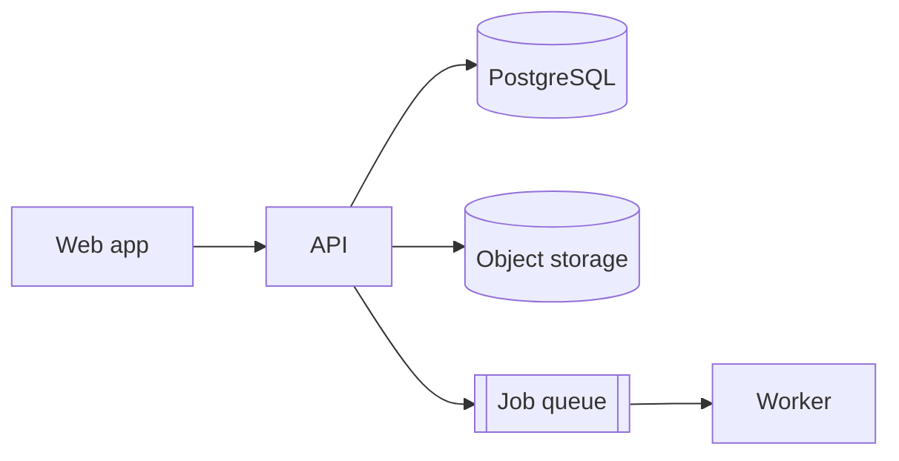

# Kiến trúc: Tên sản phẩm

## 1. Tổng quan

Mô tả 3–5 câu: các khối chính và dữ liệu chạy qua chúng thế nào.

## 2. Stack
| Tầng | Lựa chọn | Lý do |
|---|---|---|
| Frontend | | |
| Backend | | |
| Database | | |
| Auth | | |
| Hạ tầng / deploy | | |
| Quan sát (log, error, metric) | | |

## 3. Module (modular monolith)
| Module | Trách nhiệm | Bảng sở hữu | Phụ thuộc |
|---|---|---|---|
| auth | đăng nhập, phiên, chọn tenant | users, memberships | - |
| ... | | | |

## 4. Data model (nháp)
Mô hình tenancy: shared schema + tenant_id + RLS / schema-per-tenant / DB-per-tenant. Lý do: ...

| Entity | Thuộc tenant? | Trường chính | Quan hệ |
|---|---|---|---|
| tenants | (gốc) | id, slug, name, plan | - |
| users | không (global) | id, email | n-n tenants qua memberships |
| ... | có | | |

## 5. Luồng quan trọng
- Đăng nhập và chọn tenant: ...
- Luồng nghiệp vụ chính: bước 1 → 2 → 3 (thành phần nào làm gì)

## 6. Quy ước kỹ thuật
- ID: UUID (v7 nếu DB hỗ trợ) dạng string trong API
- Thời gian: lưu UTC (timestamptz), API dùng ISO 8601
- Tiền: số nguyên đơn vị nhỏ nhất + mã tiền tệ
- Format lỗi API: xem docs/contracts
- Cấu trúc thư mục: ...

## 7. Quyết định kiến trúc (ADR ngắn)
| # | Quyết định | Lý do | Phương án đã loại | Khó đảo ngược? |
|---|---|---|---|---|
| 1 | | | | có / không |

## 8. Rủi ro kỹ thuật
| Rủi ro | Khả năng | Ảnh hưởng | Cách giảm |
|---|---|---|---|
