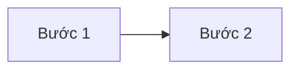
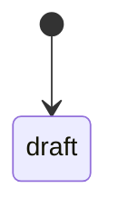

# Nghiệp vụ: Tên sản phẩm

_Cập nhật: YYYY-MM-DD · Nguồn: phỏng vấn user, file mẫu, research đối thủ_

## 1. Thuật ngữ
| Thuật ngữ | Định nghĩa | Tên trong code | Ghi chú |
|---|---|---|---|

## 2. Vai trò và quyền
| Hành động | Vai trò A | Vai trò B | Vai trò C |
|---|---|---|---|

## 3. Quy trình chính
### 3.1 Tên quy trình

## 4. Thực thể và vòng đời
### Thực thể X
- Trường chính: ...
- Quan hệ: ...

## 5. Quy tắc nghiệp vụ
| Mã | Quy tắc | Ví dụ | Nguồn |
|---|---|---|---|
| BR-01 | | | user / tài liệu / suy luận (cần xác nhận) |

## 6. Ngoại lệ và trường hợp biên
| Tình huống | Xử lý mong muốn |
|---|---|

## 7. Câu hỏi mở
- [ ] ...
