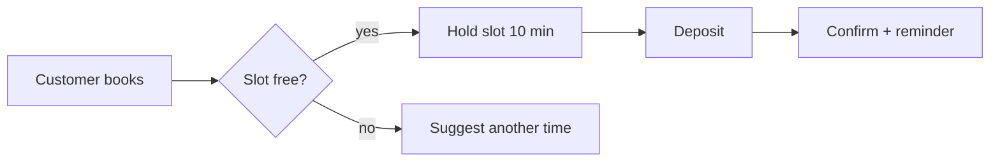
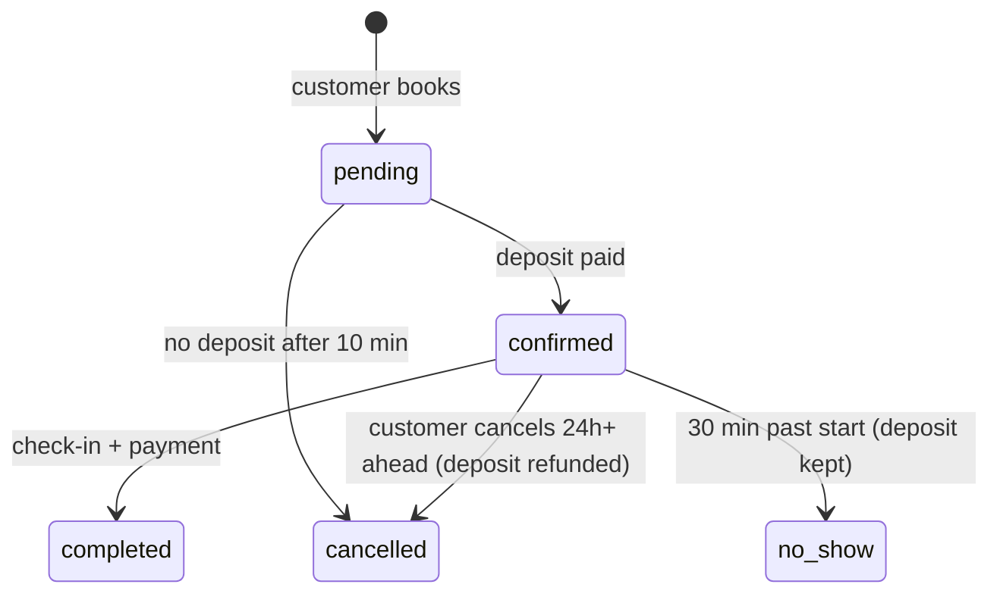

# Domain analysis

Goal: understand how the business really runs before turning it into tables, APIs and screens. Code that gets the business wrong still passes tests, because the tests share the same misunderstanding; only real users notice, and by then fixing it is very expensive.

## Contents
1. Gathering information
2. Shared glossary
3. Roles and permissions
4. Workflows
5. Entities and lifecycles
6. Business rules
7. Exceptions and edge cases
8. Feeding later steps

## 1. Gathering information

- Ask the user how the work is done **today** (Excel, Zalo, paper, old software). The current process reveals exceptions an idealized description leaves out.
- Ask for real samples: Excel files, invoices, forms, screenshots of the old software. One real Excel file often reveals more rules than a whole description session.
- Research competitors and products in the same industry (web search if available): which features are standard and users will expect by default (e.g. spa software needs appointment reminders, prepaid cards, staff commissions).
- Record the source of each fact: the user said it, a document, or your inference. Inferences must be confirmed by the user.

## 2. Shared glossary

Glossary of domain terms (in the user's language) ↔ code names, used consistently in docs, UI, DB and API. One concept with two names ("customer" and "user") breeds bugs and misunderstandings.

| Term | Definition | Code name | Notes |
|---|---|---|---|
| Khách hàng | A person who uses the spa's services | `customer` | Not `user` (a person who logs into the system) |
| Lịch hẹn | A time slot a customer books for a service | `appointment` | |

## 3. Roles and permissions

A role × action matrix. State the scope: "staff edit **their own** appointments" differs from "staff edit **all** of the branch's appointments".

| Action | Owner | Branch manager | Staff | Customer |
|---|---|---|---|---|
| View revenue | ✅ whole system | ✅ own branch | ❌ | ❌ |
| Create appointment | ✅ | ✅ | ✅ | ✅ own only |

## 4. Workflows

Draw the main flows in mermaid (flowchart or sequence): who does what, in what order, how the system responds. Draw both **current** and **desired** when the software changes how users work.

## 5. Entities and lifecycles

For each important entity: key fields, relations, and a **state machine**: which states, allowed transitions, who may trigger them, conditions, side effects (send a message, refund, deduct stock).

The state machine becomes a CHECK constraint or enum in the DB, transition functions in the service, and tests for every valid and invalid transition.

## 6. Business rules

Number them for reference from task cards and tests: `BR-01`, `BR-02`... Every rule must be verifiable.

- Calculations: price, discounts, VAT, commissions, order of application, **rounding** (VND has no decimals: at which step to round, up or down).
- Limits: maximum quantities, durations, quotas.
- Time: time zones (store UTC, display Asia/Ho_Chi_Minh), holidays, business hours, what "24h before" is measured from.
- Legal rules that affect data: e-invoices, personal data, administrative addresses. Example: from 1 July 2025 Vietnam abolished the district level and merged provinces into 34 provinces and cities, so the address model and old data must account for it.

## 7. Exceptions and edge cases

For each flow, ask in turn: cancelled midway? done twice (double click, flaky network)? two people at once (last slot, out of stock)? edited after being finalized (price change after invoicing)? undo? missing or malformed data? user without permission? The answers become acceptance criteria.

## 8. Feeding later steps

- Glossary → table, column, API and component names.
- Roles and permissions → authorization model in ARCHITECTURE.md, permission tests.
- State machines and rules → DB constraints, task card acceptance criteria (citing `BR-xx`), tests.
- Exceptions → acceptance criteria and tests for error paths.
- Unanswered questions → "Open questions" in DOMAIN.md; never decide for the user.
