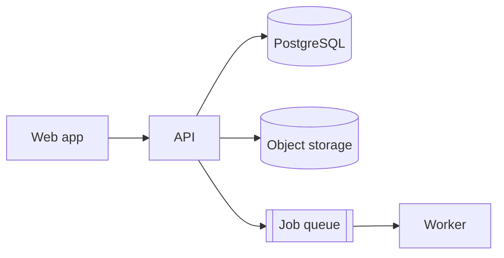

# Architecture: Product name

## 1. Overview

3–5 sentences: the main blocks and how data flows through them.

## 2. Stack
| Layer | Choice | Reason |
|---|---|---|
| Frontend (web) | | |
| Mobile / desktop app (if any) | | |
| Backend | | |
| Database | | |
| Auth | | |
| Infrastructure / deploy | | |
| Observability (logs, errors, metrics) | | |

## 3. Modules (modular monolith)
| Module | Responsibility | Owned tables | Depends on |
|---|---|---|---|
| auth | login, sessions, tenant selection | users, memberships | - |
| ... | | | |

## 4. Data model (draft)
Tenancy model: shared schema + tenant_id + RLS / schema-per-tenant / DB-per-tenant. Reason: ...

| Entity | Tenant-owned? | Key fields | Relations |
|---|---|---|---|
| tenants | (root) | id, slug, name, plan | - |
| users | no (global) | id, email | n-n tenants via memberships |
| ... | yes | | |

## 5. Key flows
- Login and tenant selection: ...
- Main business flow: step 1 → 2 → 3 (which component does what)

## 6. Technical conventions
- IDs: UUID (v7 if the DB supports it) as strings in the API
- Time: stored in UTC (timestamptz), ISO 8601 in the API
- Money: integer in the smallest unit + currency code
- API error format: see docs/contracts
- Folder structure: ...

## 7. Architecture decisions (short ADRs)
| # | Decision | Reason | Rejected options | Hard to reverse? |
|---|---|---|---|---|
| 1 | | | | yes / no |

## 8. Technical risks
| Risk | Likelihood | Impact | Mitigation |
|---|---|---|---|
