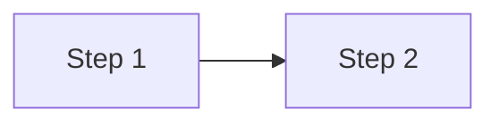
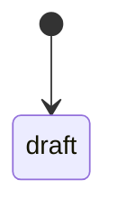

# Domain: Product name

_Updated: YYYY-MM-DD · Sources: user interviews, sample files, competitor research_

## 1. Glossary
| Term | Definition | Code name | Notes |
|---|---|---|---|

## 2. Roles and permissions
| Action | Role A | Role B | Role C |
|---|---|---|---|

## 3. Main workflows
### 3.1 Workflow name

## 4. Entities and lifecycles
### Entity X
- Key fields: ...
- Relations: ...

## 5. Business rules
| ID | Rule | Example | Source |
|---|---|---|---|
| BR-01 | | | user / document / inferred (needs confirmation) |

## 6. Exceptions and edge cases
| Situation | Expected handling |
|---|---|

## 7. Open questions
- [ ] ...
